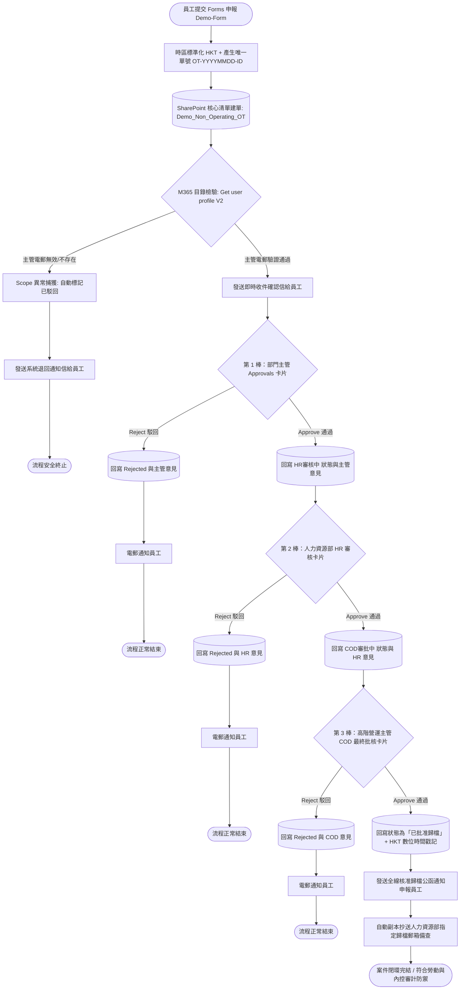

# EnterpriseDemo-NOTAS: 企業非營運時段考勤治理架構展示
### Enterprise Demo: Non-Operating Time Attendance System (Demo-Form)

> **"Zero-License, Multi-Tier Attendance & Anti-Fraud Governance Engine"**  
> **「零額外授權成本、多級審批與數位審計鏈之考勤治理系統展示」**

---

## 📌 專案摘要 (Executive Summary)

**This repository is an Enterprise Demo showcasing how to implement Governance-as-Code using M365 and Zero-Trust architecture.**

本專案為學術與架構研究用途，展示如何將企業傳統紙本「非營運時段上班記錄表 (Demo-Form)」全面數位化。以 **Microsoft 365 原生生態（Forms、SharePoint Online、Office 365 Users 及 Approvals）** 為基礎架構，在**無須額外採購 Power Platform Premium 授權**的前提下，實現「員工身分鎖定填報 ➔ 組織目錄防呆驗證 ➔ 收件即時確認 ➔ 跨層級多棒審批 ➔ 自動狀態回寫歸檔 ➔ 全鏈路閉環通報」的全自動化作業。

---

## 🏛️ 流程生命週期與治理閉環 (Workflow Lifecycle)

---

## 📋 業務治理矩陣 (Governance Matrix)

| 階段 | 責任角色 | 承載平台 / 技術 | 處置動作與審計紀錄 |
| --- | --- | --- | --- |
| **填報與建單** | 申報員工 | Microsoft Forms + SharePoint | 鎖定組織身分驗證，自動產生唯一單號（`OT-YYYYMMDD-ID`），初始狀態寫入 `主管審批中`。 |
| **目錄防呆驗證** | 自動化引擎 | Office 365 Users (`Get user profile`) | 向 M365 目錄檢驗主管電郵有效性。若無效則透過 Scope 攔截退回並標記 `已駁回`，防止流程無效掛起。 |
| **收件確認** | 自動化引擎 | Outlook (Office 365) | 驗證通過後即時發信告知員工申報單號與審批主管姓名，落實勞資溝通透明度。 |
| **第 1 棒主管審批** | 部門主管 | Outlook / Teams Approvals | 動態派發至部門主管；駁回即更新狀態並發信；通過則推進狀態至 `HR審核中`。 |
| **第 2 棒 HR 審核** | 人力資源部 | Outlook / Teams Approvals | 派發至 HR 審核郵箱；覆核非營運工時合規性與必要性，通過推進至 `COD審批中`。 |
| **第 3 棒 COD 批核** | 高階營運主管 | Outlook / Teams Approvals | 營運高層最終決策批核；駁回即時通知，通過則將 SharePoint 更新為 `已批准歸檔`。 |
| **全鏈路閉環歸檔** | 系統閉環 | Outlook (Office 365) | 自動發送正式核准公函通知申報員工，並副本 (Cc) 人力資源部備查核薪，完成完整數位審計鏈。 |

---

## ⚖️ 合規與標準對照 (Compliance & Standards Alignment)

本專案架構遵循國際管理體系標準與一般性法律架構設計，並精準界定適用範圍：

### 1. 核心法律與隱私保護 (Privacy & Legal Governance)

* **個人資料（私隱）保護原則 (e.g., PDPO)**：
* **收集目的與方式**：表單明確告知工號、出勤時間之收集目的，並備有隱私收集聲明 (PICS)。
* **資料準確性、保留與使用**：主管電郵透過目錄驗證，資料僅用於出勤核實與工時備查，訂定明確保留期。
* **資料保安**：嚴格限制 SharePoint 清單存取權限，僅授權主管與 HR 查閱。

* **僱傭與勞工法規要求**：提供具備不可篡改時間戳記之出勤記錄，作為工時核實、補償及勞資爭議之法定舉證依據。

### 2. ISO 國際體系認證對齊 (ISO Management Standards)

* **ISO/IEC 27001 (資訊安全) & ISO/IEC 27701 (隱私資訊)**：
* **存取控制 (Access Control)**：實施最小權限原則（RBAC），避免內部通訊錄直接外露於未授權介面。
* **操作日誌不可篡改性 (Audit Logging)**：審批過程由 M365 Approvals 獨立儲存電子簽章，並自動回寫標準時間。

* **ISO 9001 (品質管理體系)**：
* **成文資訊管理**：將傳統紙本紀錄規範化、版本化與數位化，確保作業一致性與可追溯性。

* **ISO 45001 (職業健康與安全管理體系)**：
* **運行策劃與危險辨識**：有效掌握員工於非正常營運時段（深夜、假日、惡劣天氣）之出勤狀態，強化單獨作業（Lone Working）與超時工作之職安風險控管。

### 3. 法規適用性豁免聲明 (Regulatory Applicability & Exemption Notice)

* **EU AI Act / ISO/IEC 42001 (AI 治理標準)**：**不適用 (Not Applicable)**。本系統架構完全採用「確定性條件分支與邏輯判斷（Deterministic Rule-based Workflows）」，未包含任何自主學習、統計推論或生成式 AI 演算法，特此聲明排除。
* **跨境數據法規 (如數據出境安全評估 / GDPR 跨境傳輸條款)**：**不適用 (Not Applicable)**。本展示架構預設員工資料僅限於本地企業內部流轉，不涉及任何跨法域數據出境傳輸行為。

---

## ⚙️ 技術架構亮點 (Technical Architecture)

1. **零額外授權成本 (Zero-License Low-Code)**：全流程僅依賴企業 M365 E3/E5 或商業版內建之標準連接器（Standard Connectors），替企業節省昂貴的 Power Platform Premium 授權。
2. **目錄級異常防禦機制 (Directory-Level Exception Handling)**：透過 `Get user profile (V2)` 驗證電郵，並配置 Scope 之 `run after has failed`，徹底根絕輸錯主管電郵導致審批卡死之系統缺陷。
3. **多階狀態機設計 (Multi-Tier State Machine)**：狀態欄位以標籤清晰呈現進度（`主管審批中` ➔ `HR審核中` ➔ `COD審批中` ➔ `已批准歸檔` / `已駁回`），保障多部門協同順暢。
4. **標準審計時間戳 (Timezone Normalization)**：利用 `Convert time zone` 將 UTC 雲端時間統一轉為本地標準時間，符合審計日誌法定標準。

---

## ⚠️ 免責聲明 (Disclaimer)

**Disclaimer:** This project is a generic enterprise demo created for academic, portfolio, and architectural research purposes. All data, organizational names, and endpoints used within this repository are fictional or generic placeholders. It does not represent the actual operational data or internal systems of any real-world enterprise.

**免責聲明：** 本專案為學術、作品集與架構研究用途之通用企業展示（Enterprise Demo）。系統內展示之所有數據、組織名稱、人員配置及端點均為虛構或通用佔位符，絕無涉及或影射任何真實企業之實際營運機密。

## 📄 版權與聲明 (License)

本專案採 MIT License 授權發佈。

